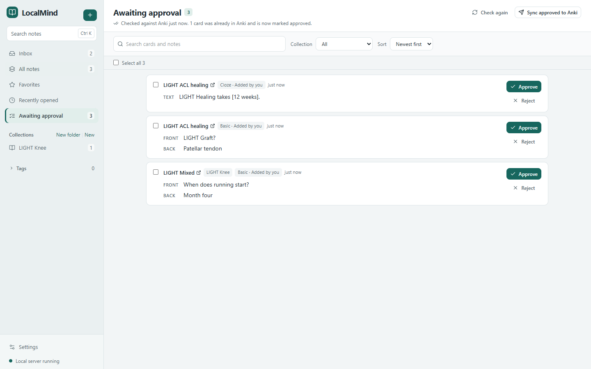
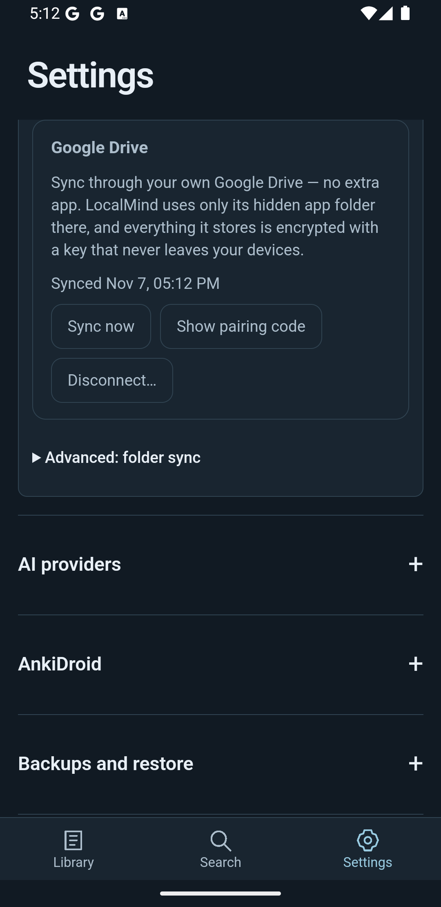

# LocalMind

**Your notes. Connected.** A local-first workspace for notes, learning and memory on Windows and Android.

[Website](https://mohammadalikid.github.io/LocalMind-releases/) · [Downloads](https://github.com/MohammadAliKid/LocalMind-releases/releases/latest)
· [Privacy](https://mohammadalikid.github.io/LocalMind-releases/privacy/) · [Terms](https://mohammadalikid.github.io/LocalMind-releases/terms/)

**Open volume** is LocalMind’s official brain-and-book identity. Windows and Android branding is included in the versions below.

## Downloads and platform status

| Platform | Actual version | Official download |
|---|---|---|
| Windows 10/11 x64 | 0.6.16 | [Windows installer](https://github.com/MohammadAliKid/LocalMind-releases/releases/download/v0.6.16/LocalMind-Setup.exe) |
| Android 7+ | 0.6.16 / code22 | [Android APK](https://github.com/MohammadAliKid/LocalMind-releases/releases/download/v0.6.16/LocalMind-Android-0.6.16.apk) |
| Mac — Apple Silicon | 0.5.0 — affected | [Retained DMG](https://github.com/MohammadAliKid/LocalMind-releases/releases/download/v0.5.1/LocalMind-0.5.0-mac-arm64.dmg) |
| Mac — Intel | 0.5.0 — affected | [Retained DMG](https://github.com/MohammadAliKid/LocalMind-releases/releases/download/v0.5.1/LocalMind-0.5.0-mac-x64.dmg) |

[Release notes](https://github.com/MohammadAliKid/LocalMind-releases/releases/tag/v0.6.16). Windows 0.6.16;
Android 0.6.16/code22; Mac 0.5.0 remains affected. **Defer Mac installation**:
Apple Silicon's resource seal is invalid; Intel is unsigned. No new Mac build is included; repair is reserved for 0.7.0.

Windows installers are **not Authenticode-signed**. In-app updates retain the existing Ed25519 identity.
Android updates retain the package ID and permanent certificate; install over the existing app to preserve data.
Requires Android System WebView 111+. AnkiDroid is optional and installed separately.

Android signing certificate SHA-256: `91c92f7cd107dfc977661f0497b2954bfcb5d789f52dcb7f12e022bfcb61bd75`.

SHA-256 download checksums

| File | SHA-256 |
|---|---|
| LocalMind-Setup.exe | `d7bf9445f7e43dde4a031a878d7de815de3d0f895e563cb7b3cbd27dc3372670` |
| LocalMind-Android-0.6.16.apk | `06ae6534e06c598096153628544233aa6654ab5481b4da6dd986602aecb59fa3` |
| LocalMind-0.5.0-mac-arm64.dmg | `27e671603cbfbbadaaf6456d491dc6d23c3899ee64cdac5c16bb82de2f7c247a` |
| LocalMind-0.5.0-mac-x64.dmg | `d213ba27e67c957c85753e74e3a6597f9de759beea9af73d87b2973d51fcb097` |

## A local library for what you learn

- **Write and find.** Markdown, images, checklists, autosave, history, favorites, collections, tags and local full-text search.
- **Organize with control.** Optional AI suggests titles, tags and filing. Manual choices win; source text stays yours.
  New collections and generated cards require your approval. Related notes are discovered locally.
- **Study and remember.** Study Mode, editable Basic/Cloze cards, and safe synchronization to the default
  Anki deck **`#LocalMind`**. Permanent card identities prevent retry duplicates. Android integrates with AnkiDroid.
- **Connect your devices.** Encrypted, app-private Google Drive sync and optional shared-folder sync with Syncthing.
  Each device keeps its own database; conflicting edits are kept. Image-inclusive backups support recovery.
- **Choose your AI.** Bring your own provider or work without AI. No LocalMind subscription is required;
  optional providers may charge or require subscriptions.
- **New in 0.6.16.** Long notes are analysed in full: Organize and card suggestions send a long note in sections instead of skipping everything after 12,000 characters, and LocalMind asks once, with the number of requests, provider and model, before any run that needs more than one AI request. Several question styles at once, the most relevant existing tags offered to the AI with variants mapped to your tags, and complete "What's new" notes during updates.
- **0.6.15.** No more duplicate Anki cards when several devices send cards: a card already sent from another device waits until your Anki has it (or is added only to a separate Anki collection), and edits from any device update the same Anki note. Collections can send new cards to their own Anki decks, cards can be edited directly in Awaiting Approval (desktop), and Windows can offer an optional, previewed crash report after an unexpected close.
- **0.6.14.** Reading themes — Midnight, OLED Black, Warm Paper and Forest besides System, Light and Dark (on Android with any accent colour) — and one clear progress bar for library downloads, syncing and updates, announced to screen readers at sensible steps.
- **0.6.13.** **Sync health** shows what is saved here, uploaded, and confirmed by each of your other devices (a device counts only after it confirms it applied your changes), plus offline devices, problems and automatic repairs. A weekly read-only check of this device's database, a daily Google Drive double-check for files the change list missed, Organize title suggestions that stay the same on every device and across restarts, and All Notes keeps your place when you accept a suggested title.
- **0.6.12 (Windows).** Fixes a remaining case of the 0.6.11 sync problem: a Windows PC re-connected to
  the same library could keep old copies of another device's change files and still miss that device's new notes and
  edits. Windows now sets those old copies aside (kept 30 days, never uploaded) once the files themselves prove the
  other device's change log restarted; a briefly incomplete Google Drive listing never triggers it. No reset, new
  pairing code or re-joining. Android stays at 0.6.11 and needs no update.
- **0.6.11.** Fixes Google Drive sync from a device that had rejoined the library (for example after the
  library was set up again): its new notes and edits could stop reaching other devices without any error, typically
  Android → Windows. Update the device that is missing changes; what is already waiting in Google Drive then arrives
  by itself. No reset, new pairing code or re-joining is needed, and nothing is duplicated.
- **0.6.10.** Google Drive sync downloads several files at once (up to 4 on Windows, 3 on Android), so
  joining a library on a new device is 3–4 times faster and catching up after time away 2–3 times faster on real
  Google Drive. Uploads stay one at a time, because Google Drive processes them one by one anyway. Every transfer
  keeps its own time limit; Disconnect stops a sync at once, and when Google Drive asks LocalMind to slow down every
  transfer backs off together. The sync format is unchanged: 0.6.9 and 0.6.10 devices sync with each other.
- **0.6.9.** Joining a Google Drive library with its pairing code shows progress, can be cancelled and
  resumes after a restart instead of appearing stuck. Drive sync is incremental end to end: a sync with no changes
  is one small request, Android no longer downloads its sync history and images again after the app restarts, and
  reconnecting a device fetches only what changed.
- **0.6.8.** Android folder sync can no longer freeze the app: **Stop syncing** is always available and
  Turn off takes effect at once, even when the shared folder stops responding. Google Drive adds **Can't find your
  pairing code?**, Reconnect with a remembered code, the signed-in account, **Use another Google account** and
  separate Sign out / Revoke. Pairing codes are hidden from screenshots and removed from bug reports.
- **Windows 0.6.6 features preserved.** Awaiting approval across your library, Stop generating, and Report a Bug /
  Request a Feature with an exact preview before sending. Feedback reaches the developer's private tracker.

## Optional AI and its limits

| Provider | Cost / limits | Windows | Android |
|---|---|---|---|
| ChatGPT sign-in | Your subscription and plan limits; preview eligibility applies | Yes | Not available |
| OpenAI API key | Separate usage billing; ChatGPT subscription does not include API credits | Yes | Not available |
| Google Gemini | Model/account-dependent free tier or paid usage; free-tier privacy differs | Yes | Yes |
| OpenRouter | Provider-verified free models or paid usage | Yes | Yes |
| Anthropic API | Separate paid API usage | Yes | Yes |
| LM Studio | Local model on your PC; hardware requirements apply | Yes | Not available |

Free-only mode refuses a model when its current free status cannot be verified. Gemini catalog/account limits vary;
unverified billing is not treated as free. Notes are sent only to the provider you explicitly choose, after consent.

## Sync, backups and privacy

Notes, attachments, search and collections live on your device. No LocalMind account or hosted notes database is required.
AI keys and sign-ins are protected by the operating system and excluded from backups and synchronization.

For Google Drive, sign in from Settings → Sync, create an encrypted library, then pair another device using its
recovery code. Keep that code safe; 0.6.8 asks you to confirm you saved it. Lost it? **Can't find your pairing
code?** shows it again from any device that still has it; if it is lost everywhere, no one can decrypt that library
and you start a new one from your local notes ([sync help](https://mohammadalikid.github.io/LocalMind-releases/help/drive-sync.html)).
Use **Use another Google account** to switch accounts; switching never deletes Drive data or merges libraries silently. LocalMind requests only `drive.appdata`; it cannot browse your other Drive files.
Google branding approval is not claimed. Disconnecting keeps local notes.

Syncthing/shared-folder sync remains available under Advanced. It exchanges journal files, never a live SQLite database.
On Android, **Stop syncing** and **Turn off sync** always respond, even if the folder hangs; they control LocalMind only,
not the Syncthing app.
The shared-folder files themselves are readable on each device; Syncthing encrypts their transport. Keep regular backups;
an export contains your note content and images, so store it privately.

 

## Install and update

Download only from this repository's [official releases](https://github.com/MohammadAliKid/LocalMind-releases/releases).
Windows installs per user and offers signed in-app updates; the installer itself is unsigned. Android verifies the
permanent release certificate when updating. Keep the installed application in place when upgrading; uninstalling
an Android app removes its private local data. Export a backup before switching devices.

## Shortcuts

| Windows | Action |
|---|---|
| Ctrl+K | Command palette |
| Alt+N | New note |
| Ctrl+Shift+N | Global Quick Capture |
| Ctrl+Shift+F | Focus Mode; Escape leaves |
| Ctrl+\ | Split View |
| Ctrl+B / I / U | Bold / italic / underline |
| Ctrl+Shift+C | Next Cloze deletion |
| Ctrl+Shift+Alt+C | Same Cloze number |

Android uses touch controls, selection gestures and native text-sharing actions. Mac shortcut presentation is prepared
in source; native execution still needs genuine Mac validation.
## Support and known limitations

Use **Settings → Feedback** in Windows 0.6.6 to report a bug or request a feature. Review the payload before Submit;
only your text and app/OS metadata are sent, with sensitive-looking text redacted. Notes, cards and images are excluded.
Delivery can be temporarily unavailable; unsent drafts are kept. Private source and operational details stay private.

Windows remains unsigned by Authenticode. Android evidence uses disposable emulators; physical-device coverage is limited.
Some AI providers and ChatGPT-plan eligibility vary by account and region. Free-only mode may disable unverified models.
Mac signing repair and genuine Apple Silicon execution remain future **0.7.0**; draft PR #7 is separate and paused.

## Links and release history

- [Official website](https://mohammadalikid.github.io/LocalMind-releases/)
- [Privacy policy](https://mohammadalikid.github.io/LocalMind-releases/privacy/) · [Terms](https://mohammadalikid.github.io/LocalMind-releases/terms/)
- [Changelog](CHANGELOG.md) · [All releases](https://github.com/MohammadAliKid/LocalMind-releases/releases)
- [Sync setup](docs/sync.md)

This repository hosts official binaries and public documentation. LocalMind source and credentials are not published here.
