

  

<h1 align="center">LocalMind</h1>

  Local-first notes that organize themselves, surface related ideas and turn into Anki flashcards. 
  Windows and Android · macOS downloads for Apple Silicon and Intel

  
  
  
  
  

  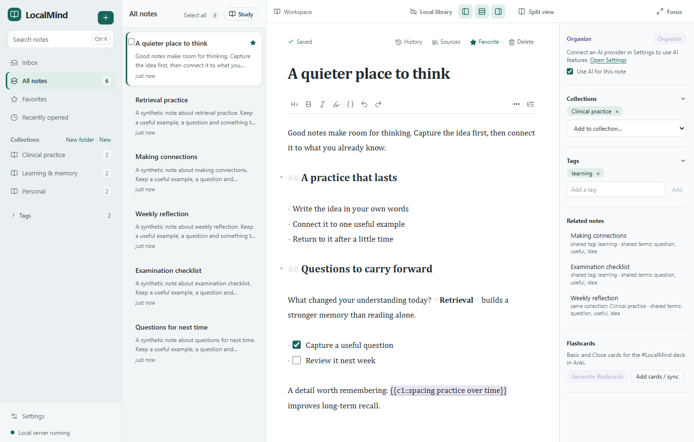

## What it does

**Android 0.5.3:** The editor and buttons fit inside the system bars when rotating or typing. Choose or change the shared Syncthing folder in Settings → Sync between devices.

**Android 0.5.2:** a redesigned phone/tablet editor, top-right tools drawer, offline Study Mode, native image paste,
image-inclusive backups and clearer local-save/folder-sync status. Windows downloads remain 0.5.1 and macOS
downloads remain 0.5.0; these desktop binaries do not contain the new Android interface.

- **Write in Markdown, formatted as you type.** Headings, checklists, tables, highlights, collapsible sections
  and images, with a toolbar, an outline and version history. Notes live in a SQLite database on your PC.
- **AI organization you stay in charge of.** One click (or automatically, if you turn it on) files a note into
  your existing collections, adds tags, writes a short summary and lists key concepts. It never rewrites your
  text, never invents collections without asking, and your own choices always win.
- **Related notes, found locally.** Shared words, tags, collections and concepts, each with the reason shown.
- **Flashcards for Anki.** Basic, Cloze and Image Occlusion cards: generated from your note, made from selected
  text, or written by hand, with quality hints. Ctrl+Shift+C makes cloze deletions as in Anki. You approve cards,
  then they sync to a `#LocalMind` deck (or your own, using your AnKing Overhaul note type if you like) without
  duplicates and without touching your review history.
- **Your choice of AI.** Your ChatGPT plan, an OpenAI API key, Google Gemini, OpenRouter, the Claude API, or a
  model running in LM Studio on your PC, with a strict Free-only mode and a privacy notice for each.
- **Sync between your devices.** PCs, Macs and Android phones stay in step through a shared folder (for example
  with Syncthing). Each device keeps its own database, and conflicting edits are kept rather than overwritten.
- **On your phone.** LocalMind for Android works offline with its own library: phone and tablet
  layouts, a Gboard-aware editor with touch Cloze/link forms, Focus and read-only Study modes, an AI/tools drawer,
  gallery/camera/pasted images, image-inclusive backups, sync with your PCs through a folder you choose,
  and AnkiDroid: approved Basic and Cloze cards go to the `#LocalMind` deck, updated in place, never duplicated.
- **Made for daily use:** resizable panels, Focus Mode, Split View, search with highlights, folders, tags,
  favorites, Inbox, a command palette (Ctrl+K), global Quick Capture
  (Ctrl+Shift+N), bulk actions, light and dark themes, automatic backups and signed automatic updates.

<table>
  <tr>
    <td width="50%">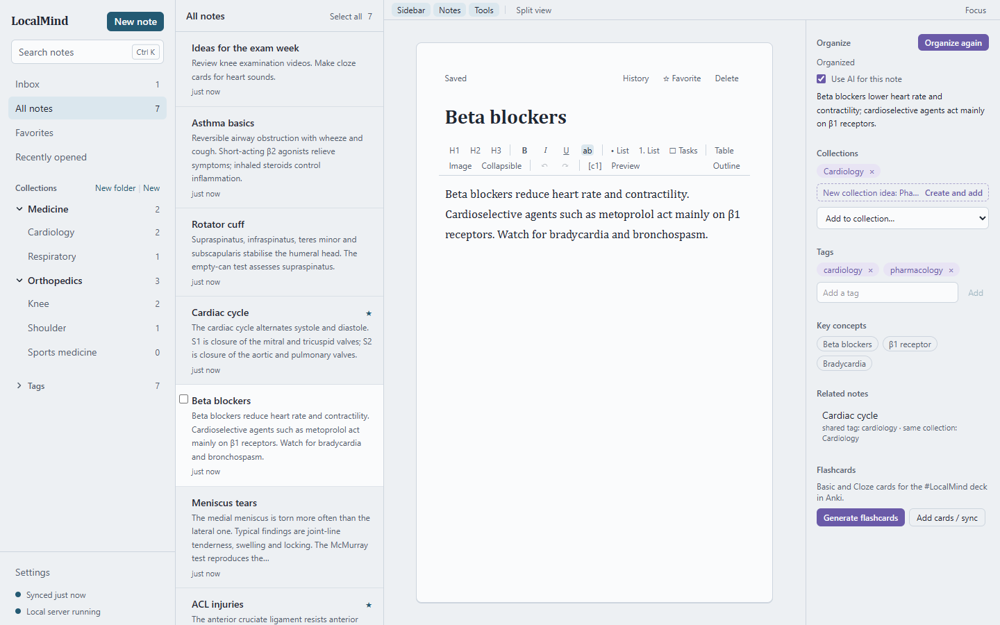 <b>AI organization.</b> Existing collections are applied; new ones are only proposed.</td>
    <td width="50%">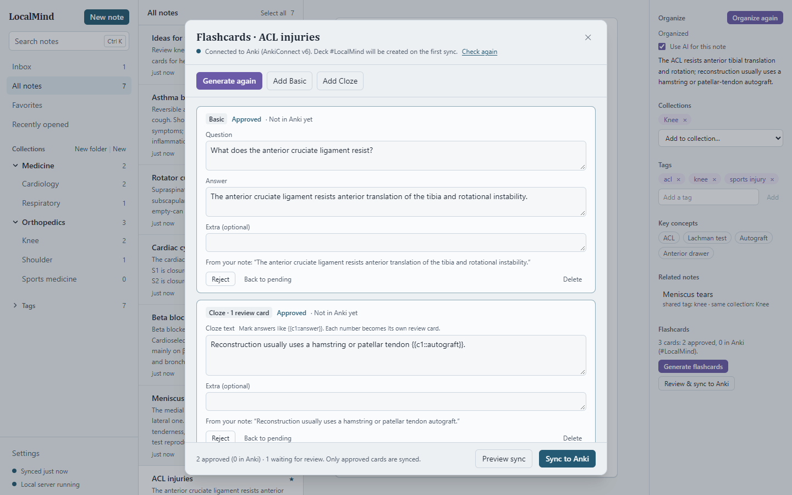 <b>Flashcards.</b> Each card quotes its source sentence; only approved cards go to Anki.</td>
  </tr>
  <tr>
    <td width="50%">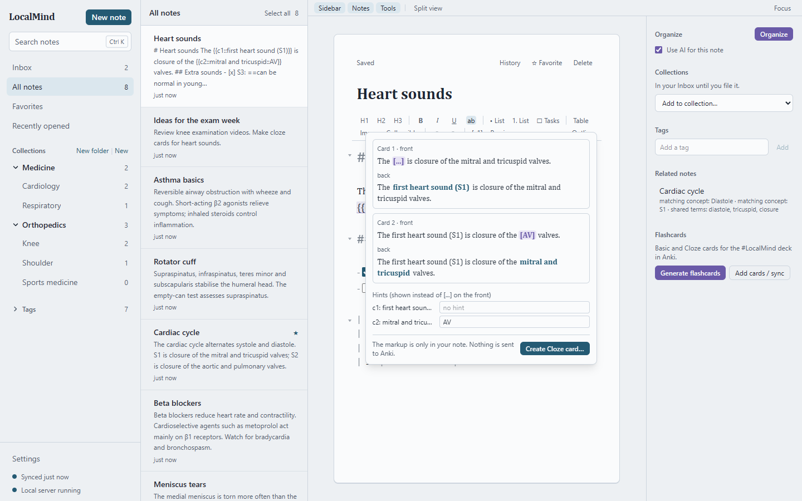 <b>Editor and Cloze preview.</b> Ctrl+Shift+C, hints, every review card previewed.</td>
    <td width="50%">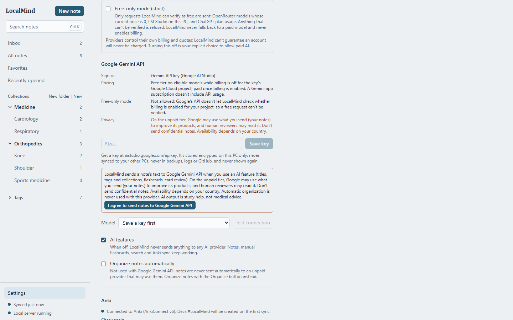 <b>AI providers.</b> Pricing, Free-only rules and privacy shown before anything is sent.</td>
  </tr>
  <tr>
    <td width="50%">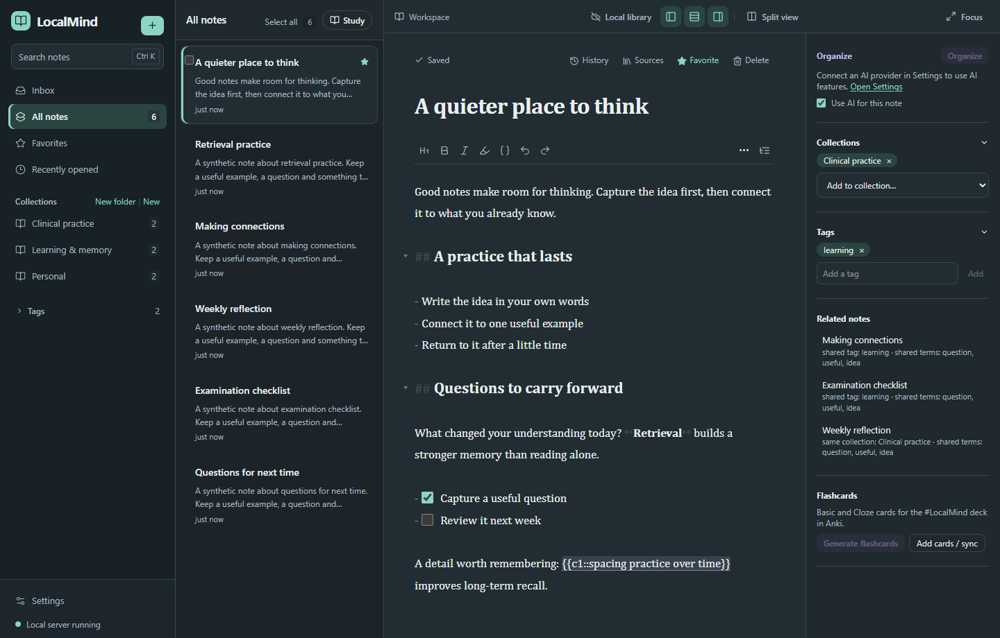 <b>Dark mode.</b> Light, Dark, or follow Windows.</td>
    <td width="50%">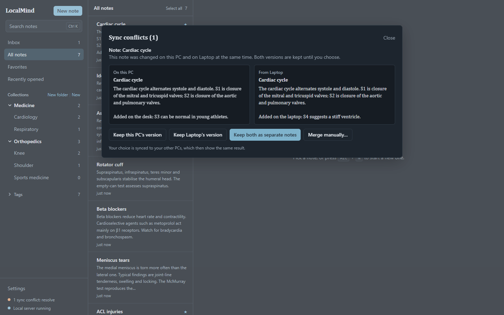 <b>Sync conflicts.</b> Both versions are kept until you choose.</td>
  </tr>
  <tr>
    <td width="50%">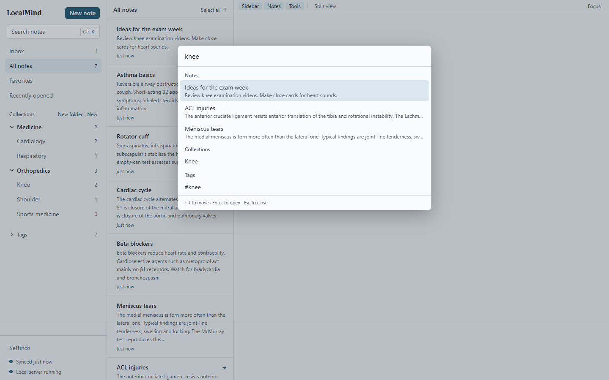 <b>Command palette.</b> Notes, places and actions behind Ctrl+K.</td>
    <td width="50%">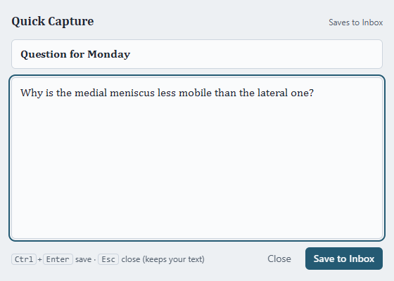 <b>Quick Capture.</b> Ctrl+Shift+N anywhere in Windows saves to the Inbox.</td>
  </tr>
</table>

<table>
  <tr>
    <td width="25%">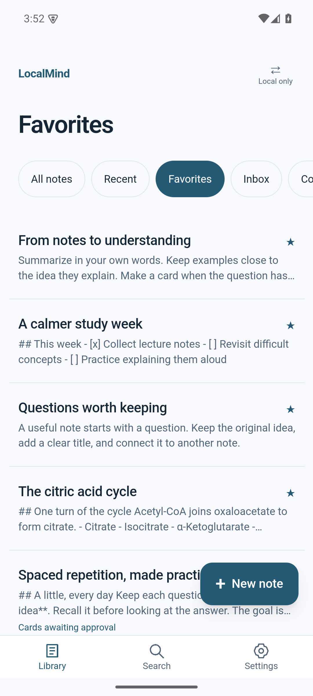 <b>Android Library.</b> Recent notes, Favorites, Inbox and templates.</td>
    <td width="25%">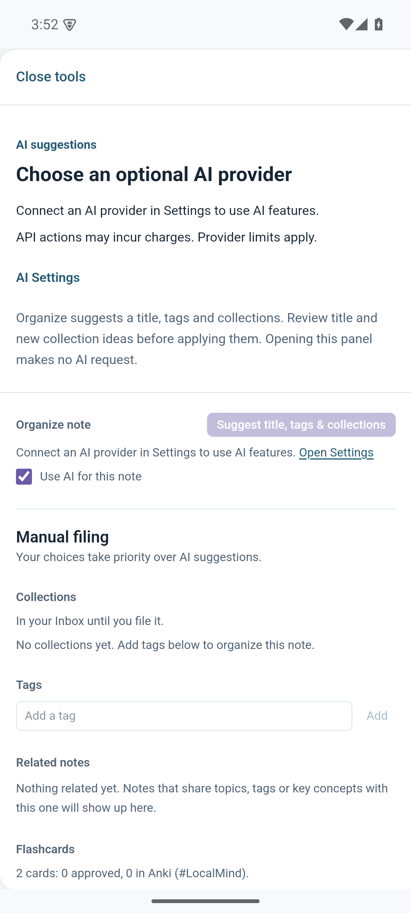 <b>Note tools.</b> AI suggestions, manual filing and cards.</td>
    <td width="50%">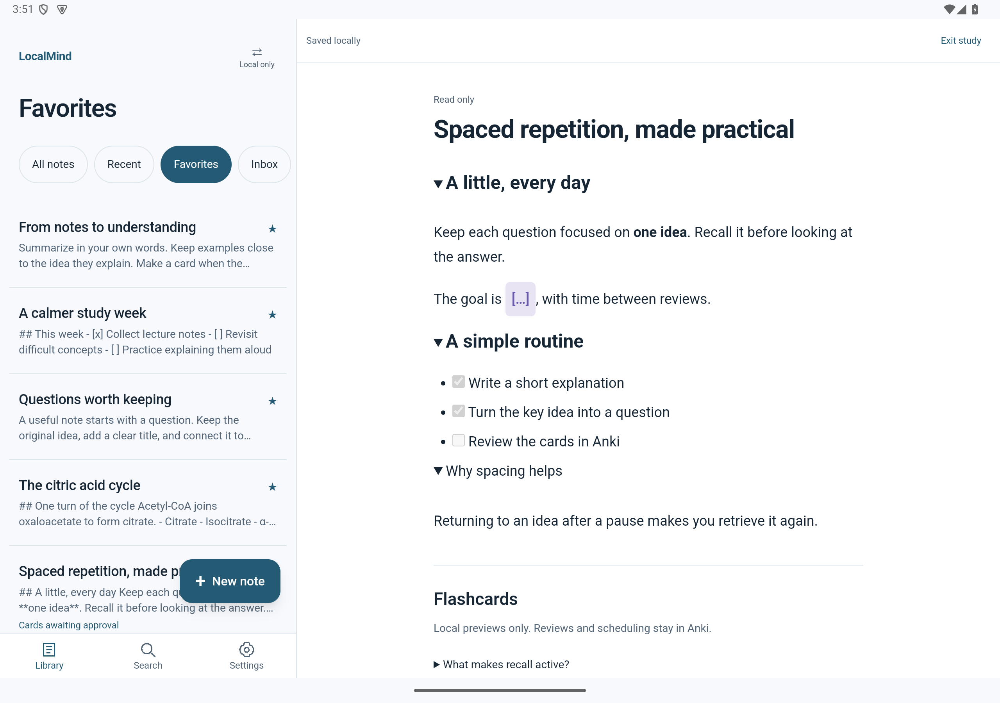 <b>Offline Study Mode.</b> Read and reveal without changing Anki reviews.</td>
  </tr>
</table>

All screenshots use synthetic demonstration notes.

> **Mac downloads affected:** The retained macOS 0.5.0 Apple Silicon package has an invalid resource seal; Intel is unsigned and also awaiting final-DMG validation. Please defer installing these Mac builds until corrected downloads are published. Windows and Android are unaffected. See [Mac launch status](docs/mac-launch.md).

## Install

| Platform | Version | Download |
|---|---|---|
| Windows 10/11 (64-bit) | 0.5.1 | [Download LocalMind for Windows](https://github.com/MohammadAliKid/LocalMind-releases/releases/download/v0.5.1/LocalMind-Setup.exe) |
| Mac — Apple Silicon | 0.5.0 | [Download LocalMind for Mac — Apple Silicon](https://github.com/MohammadAliKid/LocalMind-releases/releases/download/v0.5.1/LocalMind-0.5.0-mac-arm64.dmg) |
| Mac — Intel | 0.5.0 | [Download LocalMind for Mac — Intel](https://github.com/MohammadAliKid/LocalMind-releases/releases/download/v0.5.1/LocalMind-0.5.0-mac-x64.dmg) |
| Android 7+ | 0.5.3 | [Download LocalMind for Android](https://github.com/MohammadAliKid/LocalMind-releases/releases/download/v0.5.3/LocalMind-Android-0.5.3.apk) |

[Release notes and SHA-256 checksums](https://github.com/MohammadAliKid/LocalMind-releases/releases/tag/v0.5.3)
· Windows retains verified 0.5.1; Mac retains 0.5.0 from the last successful Mac CI run.

**Windows:** run LocalMind-Setup.exe. It installs for your account, with no administrator rights. The installer is
not Authenticode-signed yet, so SmartScreen may ask for confirmation. Compare its SHA-256 with the release page.
Settings → Updates verifies LocalMind's Ed25519 signature and file hashes before installing; it takes a backup first.

**Mac:** open the DMG and drag LocalMind.app into Applications. These builds are not Developer ID signed or notarized.
If macOS blocks the first launch, follow [Apple's instructions](https://support.apple.com/102445): after attempting to
open the app, use System Settings → Privacy & Security → Open Anyway if you trust the download. Keep Gatekeeper enabled.
The app verifies a signed update manifest and the matching DMG; quit LocalMind and replace the application manually.
Your library and Keychain data live outside the app. If the original Mac downloader times out, download the DMG here.

**Android:** open the APK and approve Android's installer. Android may ask you to allow installs from the browser or
file manager you used. Future updates use Settings → Updates: signed metadata, SHA-256, package ID, versions and the
permanent signing certificate are verified before Android's installer opens. Automatic background checks run when
Android permits; installation always needs your approval. This is a GitHub APK, not a Google Play listing.
Requires Android System WebView 111 or newer. AnkiDroid is optional; grant access when enabling card sync.

**Existing Android development installations:** save a backup and preserve images separately **before uninstalling**.
Uninstalling deletes app data. Install the official APK, restore the backup, re-enter AI credentials and choose the
sync folder again. A different signing certificate cannot update an installation in place. Backups made with
Android 0.5.2 include referenced images; older phone backups may require copying images separately.
Normal updates signed with the permanent release identity preserve app data and permissions.

Android signing certificate SHA-256: `91c92f7cd107dfc977661f0497b2954bfcb5d789f52dcb7f12e022bfcb61bd75`.

SHA-256 download checksums

| File | SHA-256 |
|---|---|
| LocalMind-Setup.exe | `25f68ebad48053a0f6b6cb2fcda79494fcfa96c90aa0c6c5aeaf96b86571b466` |
| LocalMind-0.5.0-mac-arm64.dmg | `27e671603cbfbbadaaf6456d491dc6d23c3899ee64cdac5c16bb82de2f7c247a` |
| LocalMind-0.5.0-mac-x64.dmg | `d213ba27e67c957c85753e74e3a6597f9de759beea9af73d87b2973d51fcb097` |
| LocalMind-Android-0.5.3.apk | `e2c8d1e845b3461992b3734d7445f69fe4f5e33c934cd4a4104c0678c690667c` |

## AI: optional, your choice of provider

AI is optional: notes, search, cards and sync all work without it. Pick one provider in *Settings → AI*;
LocalMind never switches providers or models on its own, and never falls back to a paid one.

| Provider | Cost | Windows / macOS | Android |
|---|---|---|---|
| Sign in with ChatGPT | Subscription: uses your ChatGPT plan's limits (an OpenAI preview) | Yes | Not yet |
| OpenAI API key | Paid, per request, on your OpenAI API account | Yes | Not yet |
| Google Gemini API key | Free tier on some models (Google may use free-tier data); paid otherwise | Yes | Yes |
| OpenRouter API key | Free models (marked `:free`) or paid models | Yes | Yes |
| Anthropic Claude API key | Paid, per request | Yes | Yes |
| LM Studio | Free, runs on your own computer | Yes | No (runs on a PC) |

- **Free-only mode** sends a request only when the provider's own data shows the model is free right now.
- **Android Gemini 0.5.2:** Recommended/Fast/Advanced groups simplify the account catalog; All compatible keeps
  advanced text models available. Limits and preview warnings are shown. Billing is not inferred from a model name
  or API-key connection, so unverified Gemini choices are disabled in strict Free-only mode.
- **Consent first:** before a new provider receives any note, you see its privacy terms and agree.
- **Keys and sign-ins** are encrypted on each device (Windows DPAPI, macOS Keychain, Android Keystore). They are
  never synced, never in backups, logs or the sync folder.
- Only the note being organized and the names of your collections and tags are sent; never your whole library.

## Privacy and local-first design

- **Your data stays on your devices:** notes, organization and flashcards are in `%LOCALAPPDATA%\LocalMind`
  (Windows), `~/Library/Application Support/LocalMind` (macOS) or the app's private storage (Android). Nothing is
  uploaded except the single note you ask AI to work on, sent to the provider you chose.
- **Local server only:** the server listens on `127.0.0.1` only, behind a strict Content-Security-Policy.
- **Credentials stay put:** they're encrypted per Windows account, and never appear in backups, logs, the
  browser or the sync folder.
- **Sync:** Syncthing encrypts traffic between your PCs. The sync folder itself holds readable files on each
  PC, just like the database. Details are in the [sync guide](docs/sync.md).

## Guides

[Sync setup](docs/sync.md) · [Privacy](docs/privacy.md) · [Verify downloads](docs/verify.md) · [Release history](CHANGELOG.md)

## Keyboard shortcuts

These are desktop shortcuts. Android provides touch formatting, Undo/Redo and Cloze/link forms above the keyboard.
Tap the top-right tools button for AI, manual filing and cards; use the overflow menu for Focus or Study Mode.
Settings → Sync chooses the shared folder; pair that folder in your file-sync app. Local save and completed folder
writes have separate indicators, and conflicts keep both versions until you choose. Never sync a live SQLite file.

On a Mac, use ⌘ for Ctrl and ⌥ for Alt.

| Keys | Action | Keys | Action |
|---|---|---|---|
| Alt+N | New note | Ctrl+K | Command palette |
| Ctrl+Shift+N | Quick Capture (anywhere) | Ctrl+Shift+F | Focus Mode (Esc leaves) |
| Ctrl+\ | Split View | Ctrl+Shift+1 / 2 / 3 | Show or hide sidebar / list / note tools |
| Ctrl+B / I / U | Bold / italic / underline | Ctrl+Shift+H | Highlight |
| Ctrl+Alt+1 / 2 / 3 | Heading 1 / 2 / 3 | Ctrl+Shift+7 / 8 / 9 | Numbered / bulleted / task list |
| Ctrl+Shift+C | Cloze (next number) | Ctrl+Shift+Alt+C | Cloze (same number) |

## Known limitations

- **Mac installation:** the published Mac builds are not Developer ID signed or notarized; the first launch may need approval in Privacy & Security. New Mac packaging is waiting for Mac CI.
- **Android:** the GitHub APK uses the permanent release key and was tested on an emulator; physical-device testing remains outstanding.
- **Android AI:** independent Android ChatGPT-plan distribution eligibility is not established in official
  documentation, so plan sign-in is unavailable. OpenAI API-key and LM Studio support remain desktop-only.
  Gemini, OpenRouter and Anthropic use their own API credentials; browsing settings never runs inference.
  Gemini billing depends on the account/model and is marked unverified; strict Free-only disables unverified choices.
- **Android data:** Image Occlusion cards are not sent to AnkiDroid. Android 0.5.2 backups include referenced images;
  older text-only backups can report missing images for explicit recovery. Saved locally waits for the actual file
  write; text still being edited has a crash draft, and force-killing Android before storage commits can lose it.
  Folder updated confirms local folder writes, not receipt on another device. No reliable always-on background sync.
  Requires Android System WebView 111 or newer. The current library view is bounded to 500 notes; search finds older notes.
- **Unsigned Windows installer:** expect a SmartScreen warning until it's code-signed.
- **Real-device testing:** sync was tested between independent installations on one PC and between an Android
  emulator and a desktop instance through real Syncthing; not yet between physical PCs and phones. AI providers
  were tested against mock servers only.
- **No sync compaction:** sync journals grow over time.

## Roadmap

- [x] 0.1: notes, AI organization, related notes, Anki flashcards, backups, Windows installer
- [x] 0.2: themes, folders, favorites, Quick Capture, command palette, bulk actions, automatic backups, signed updates
- [x] 0.3: PC-to-PC sync, public binary releases
- [x] 0.4: new editor, version history, Image Occlusion, AnKing note types, more AI providers, workspace layout
- [x] 0.5: macOS and Android test builds, AnkiDroid, phone sync through a chosen folder, quit fix
- [x] 0.5.1: permanent Android release signing, native GitHub updates, public Mac/Android downloads, isolated CI
- [x] 0.5.2: Android editor redesign, offline Study Mode, image-inclusive backups and durable sync recovery
- [ ] 0.6.0: encrypted Google Drive sync, simplified onboarding and settings overlays
- [ ] Signing (Windows and Apple Developer ID), Google Play, tests on physical devices, sync
  journal compaction, Markdown export

## License

No license has been chosen yet. All rights are reserved by the author. This repository contains downloads and user documentation only. The source repository remains private.
